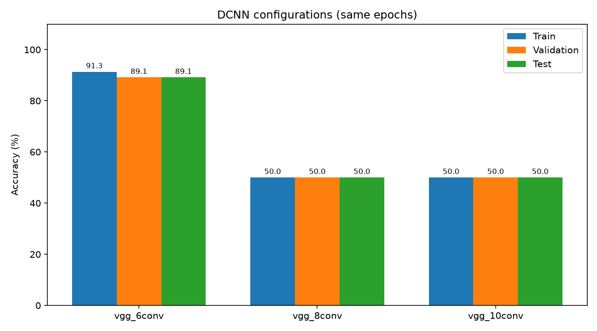
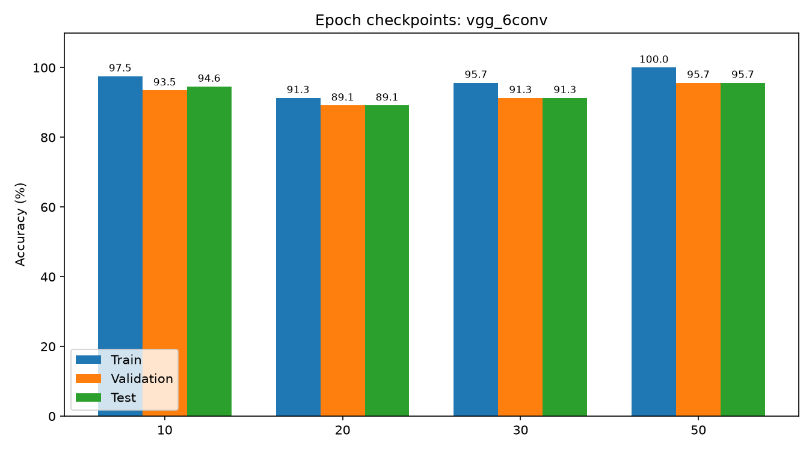
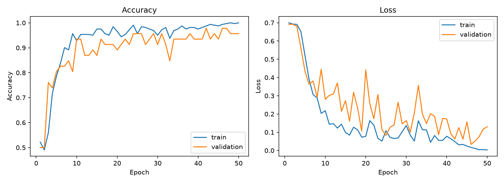
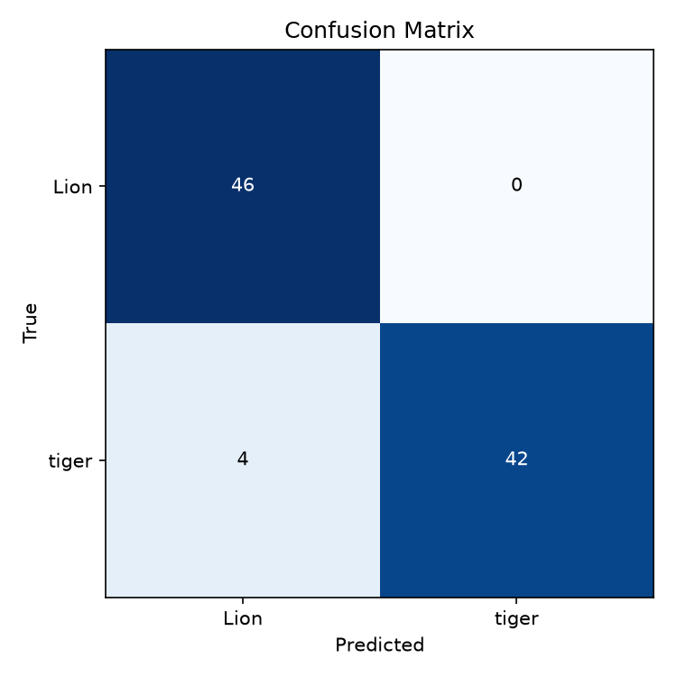
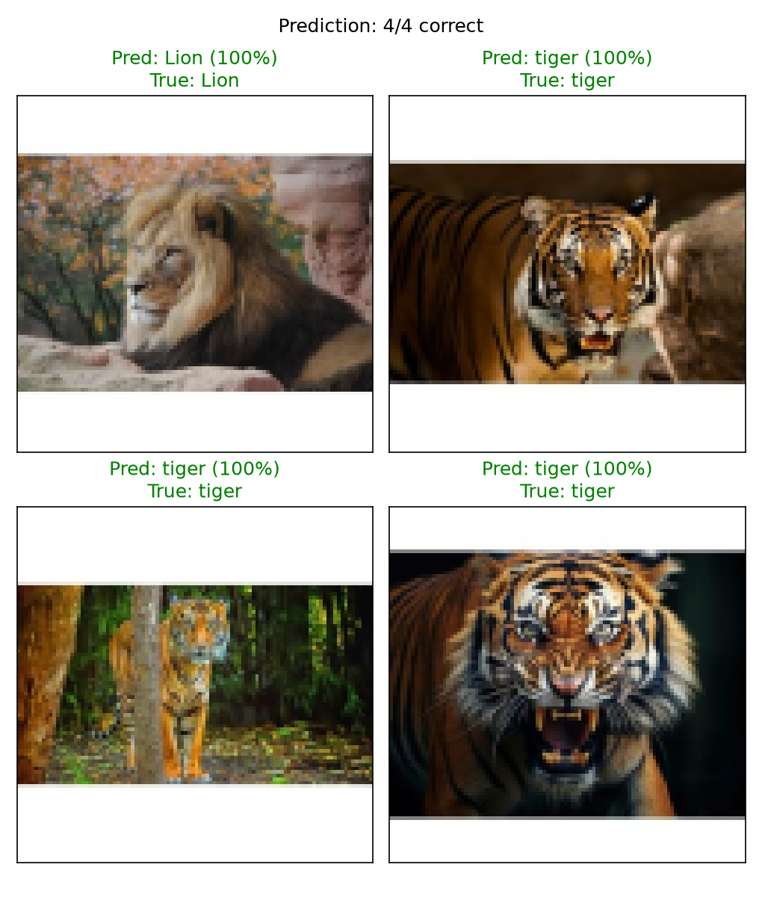

# LAB08 DCNN จำแนกภาพ Lion และ tiger

โปรเจกต์นี้ใช้ Deep Convolutional Neural Network (DCNN) แบบ VGG ย่อ มาจำแนกภาพสิงโตกับเสือ โดยใช้ dataset เดิมจาก LAB07 และเปรียบเทียบผลเมื่อเปลี่ยนจำนวน Conv layers, Dense neurons และ epochs

โมเดลใช้ Conv 3x3 ซ้อนกันเป็น block แบบ VGG โดยทดลอง 3 configurations ที่มีความลึกต่างกัน ได้แก่ 6, 8 และ 10 Conv layers

## ภาษาที่ใช้และเครื่องมือ

ใช้ **Python 3.12** เขียนโปรแกรม และ **Markdown** เขียน README

| Library | ใช้ทำอะไร |
| --- | --- |
| TensorFlow / Keras | สร้างและเทรนโมเดล DCNN |
| OpenCV | อ่านรูป แปลง BGR เป็น RGB และ resize |
| NumPy | จัดการข้อมูลภาพและบันทึก array |
| Scikit-learn | แบ่งข้อมูลแบบ stratify และคำนวณผลประเมิน |
| Matplotlib | วาดกราฟและแสดงรูป prediction |

## อ้างอิงแหล่งข้อมูล

- Dataset: [Tiger vs Lion Image Classification Dataset บน Kaggle](https://www.kaggle.com/datasets/sonalshinde123/tiger-vs-lion-image-classification-dataset)
- ใช้รูปชุดเดิมจาก [LAB07 - CNN](../LAB07%20-%20CNN/README.md) อ่านจากโฟลเดอร์ `LAB07 - CNN/Animal/` โดยตรง
- รูปทั้งหมด 460 รูป แบ่งเป็น `Lion` 230 รูป และ `tiger` 230 รูป
- ใช้ dataset และ split เดียวกับ LAB07 เพื่อเปรียบเทียบโมเดลบนข้อมูลชุดเดียวกัน

เตรียมภาพเป็น RGB ขนาด 100x100 และ normalize pixel เป็น 0-1 ด้วย `Rescaling(1/255)` ภายในโมเดล แบ่ง train 322 รูป, validation 46 รูป และ test 92 รูป ด้วย seed 42 โดยใช้ split ตรงกับ LAB07

## ผลการรันแบบรูป

### เปรียบเทียบโครงสร้าง DCNN

ทดลอง VGG แบบย่อ 3 configurations ที่ 20 epochs เท่ากัน ใช้ Adam learning rate 0.001, batch size 32 และ seed 42

| Configuration | Filters และจำนวน Conv ในแต่ละ block | Conv layers รวม | Dense neurons |
| --- | --- | ---: | ---: |
| vgg_6conv | 16×2 → 32×2 → 64×2 | 6 | 64 |
| vgg_8conv | 16×2 → 32×2 → 64×2 → 128×2 | 8 | 128 |
| vgg_10conv | 16×2 → 32×2 → 64×3 → 128×3 | 10 | 128 |

รุ่น 6 Conv ได้ validation accuracy สูงสุด 89.13% จึงนำไปทดลองจำนวน epochs ต่อ ส่วนรุ่น 8 และ 10 Conv ยังได้ accuracy 50% ในการรันครั้งนี้



### เปรียบเทียบจำนวน epochs

เทรนรุ่น 6 Conv ใหม่จนถึง 50 epochs แล้วเก็บค่าที่รอบ 10, 20, 30 และ 50 จาก training run เดียวกัน เลือก checkpoint ด้วย validation accuracy ถ้าเท่ากันดู validation loss รอบ 50 ได้ validation accuracy สูงสุดใน 4 checkpoints ที่กำหนด คือ 95.65%



### กราฟ Training และ Validation

กราฟแสดง accuracy และ loss ตลอด 50 epochs ค่า train accuracy ในกราฟมาจากช่วงเทรนที่เปิด dropout และ augmentation ส่วนแท่งเปรียบเทียบด้านบนวัดแบบ inference หลังจบ epoch



### Confusion Matrix

โมเดลสุดท้ายทาย test ถูก **88 จาก 92 รูป คิดเป็น accuracy 95.65%** โดย Lion ถูก 46 รูป และ tiger ถูก 42 รูป มี tiger 4 รูปที่ทายเป็น Lion ได้ macro F1-score ประมาณ 0.9564



### ตัวอย่าง Prediction

สุ่มภาพจาก test มาแสดง 4 รูป รอบนี้ทายถูก 4/4 รูป ส่วน accuracy รวมด้านบนคิดจาก test ทั้ง 92 รูป



ผลตัวเลขเก็บไว้ใน [comparison_configs.csv](mini-proj/outputs/comparison_configs.csv), [comparison_epochs.csv](mini-proj/outputs/comparison_epochs.csv), [metrics.json](mini-proj/outputs/metrics.json) และ [predictions.csv](mini-proj/outputs/predictions.csv)

## โครงสร้างไฟล์

```text
LAB07 - CNN/
└── Animal/                     # dataset ที่ LAB08 ใช้ร่วมกัน
    ├── Lion/
    └── tiger/

LAB08 - DCNN/
├── README.md
├── requirements.txt            # library ที่ใช้
└── mini-proj/
    ├── README.md
    ├── main.py                 # สั่งรัน pipeline ทั้งหมด
    ├── data_loader.py          # อ่านรูปและข้ามไฟล์เสีย
    ├── preprocessing.py        # แปลงสีและ resize ภาพ
    ├── split_data.py           # แบ่ง train/val/test แบบ stratify
    ├── vgg_model.py            # สร้างและเทรน VGG แบบย่อ
    ├── compare_experiments.py  # เปรียบเทียบ configs และ epochs
    ├── evaluate.py             # คำนวณ accuracy และวาดกราฟ
    ├── test_vgg.py             # โหลดโมเดลมาทายภาพตัวอย่าง
    └── outputs/
        ├── classes.json, run_info.json
        ├── X_train.npy, X_val.npy, X_test.npy
        ├── y_train.npy, y_val.npy, y_test.npy
        ├── vgg_model.keras, history.json
        ├── configurations/    # history และกราฟของแต่ละ config
        ├── comparison_configs.csv, comparison_epochs.csv
        ├── comparison_configs.png, comparison_epochs.png
        ├── training_history.png
        ├── confusion_matrix.png
        ├── prediction_sample.png, predictions.csv
        └── metrics.json, results.md, run.log
```

## สรุปการทำโปรเจกต์

เริ่มจากโหลดรูป Lion และ tiger จาก LAB07 แล้วแปลงสี ย่อรูป และแบ่งข้อมูล จากนั้นใช้ Conv 3x3 หลายชั้นร่วมกับ MaxPooling เพื่อหา feature ของภาพ ก่อนส่งเข้า Dense และ sigmoid เพื่อทายคลาส มี RandomFlip เพิ่มความหลากหลายของภาพตอนเทรน และ Dropout ช่วยลดการจำข้อมูล train มากเกินไป

จากการทดลองเลือกโมเดล `vgg_6conv` ที่ 50 epochs ได้ test accuracy 95.65% โดยใช้ validation เป็นตัวเลือก config และ checkpoint ส่วน test ใช้วัดผลโมเดลที่เลือก การเพิ่มจำนวนชั้นไม่ได้ทำให้ผลดีขึ้นทุกครั้ง เพราะรุ่น 8 และ 10 Conv ยังแยกคลาสได้ไม่ดีภายใต้การตั้งค่ารอบนี้

โปรเจกต์นี้ครอบคลุมการเตรียมภาพ สร้าง DCNN เปรียบเทียบโครงสร้างและ epochs รวมถึงประเมินผลด้วยกราฟ accuracy/loss และ confusion matrix ผลที่ได้มาจาก split และ seed เดียว จึงเป็นข้อสรุปเฉพาะการทดลองครั้งนี้
