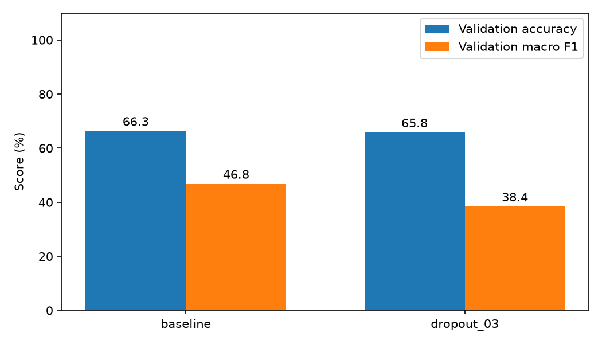
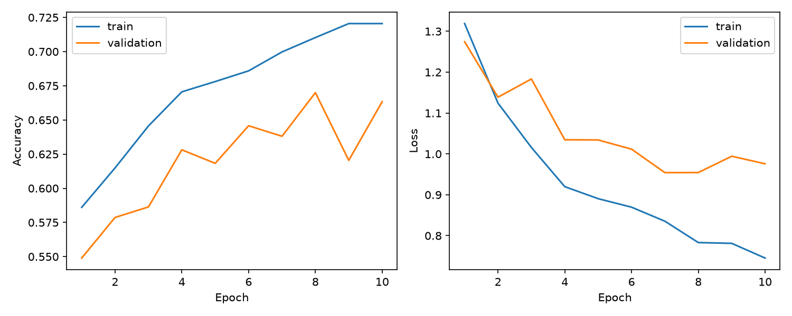
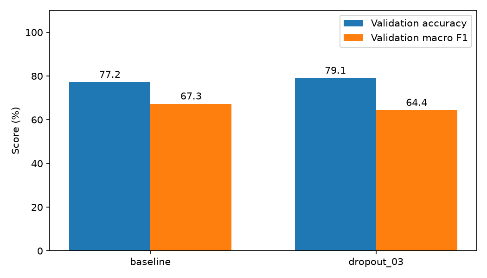
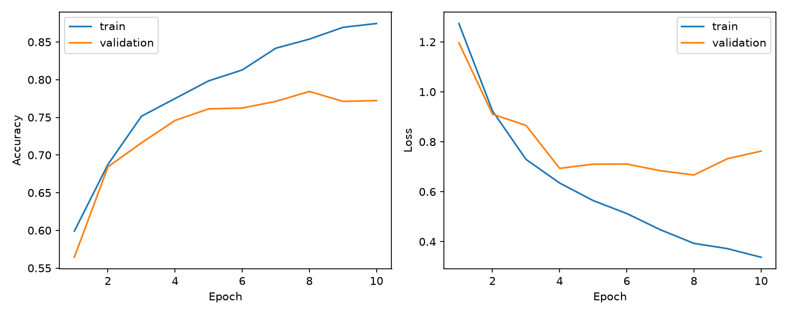
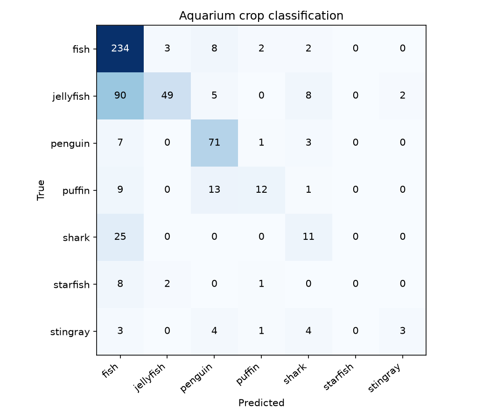
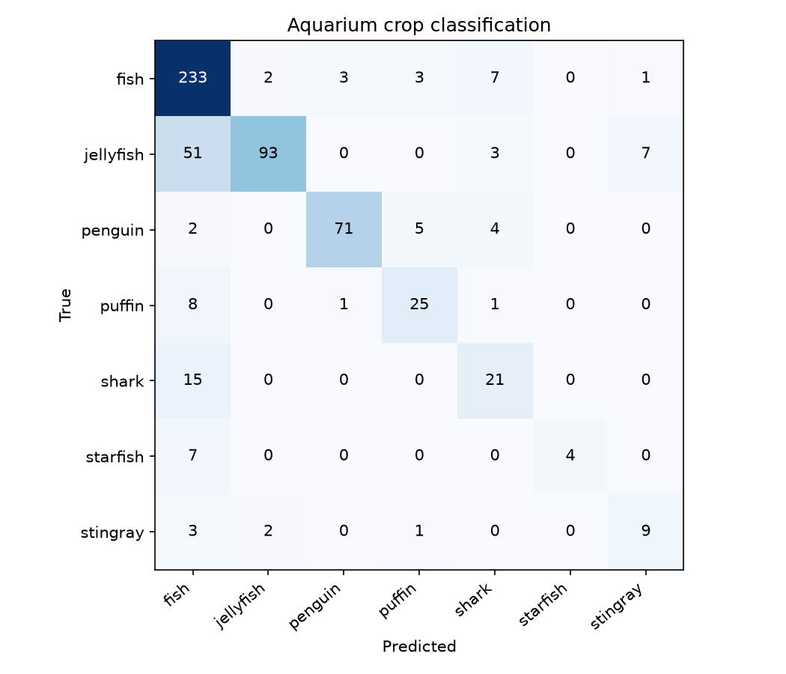
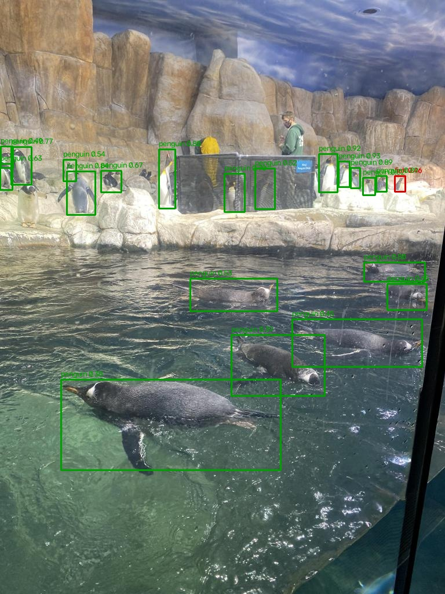
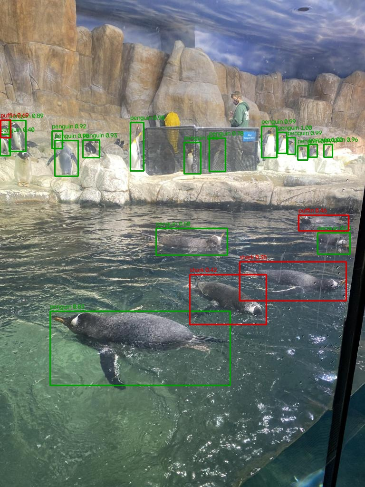

# LAB09 ทดลองจำแนกสัตว์น้ำด้วยโมเดลแบบ R-CNN และ Fast R-CNN ย่อ

ใช้ Aquarium dataset ชุดเดียวกับ LAB10 มาทดลองจำแนกภาพ crop ของสัตว์ 7 คลาส โค้ดยังคงแนวทาง baseline แบบย่อจากโครงเดิม โดยใช้กรอบ annotation ตัดวัตถุออกมาแล้วส่งเข้า CNN

## ภาษาที่ใช้และเครื่องมือ

ใช้ **Python 3.12** และ TensorFlow/Keras สร้างโมเดล ใช้ OpenCV ตัดและย่อภาพ, NumPy จัดการ array, Scikit-learn คำนวณ metrics, Matplotlib วาดกราฟ และ PyYAML อ่านรายชื่อคลาส

## อ้างอิงแหล่งข้อมูล

- Dataset: [Aquarium บน Kaggle](https://www.kaggle.com/datasets/slavkoprytula/aquarium-data-cots)
- แหล่งภาพและ annotation: [Roboflow Aquarium](https://public.roboflow.ai/object-detection/aquarium), CC BY 4.0
- อ่านข้อมูลจาก [LAB10](../LAB10-Object%20Detection%20II/README.md) โดยตรง ใช้ split เดิม train 448 รูป, validation 127 รูป และ test 63 รูป
- คลาส: `fish`, `jellyfish`, `penguin`, `puffin`, `shark`, `starfish`, `stingray`
- แนวคิดสถาปัตยกรรม: [R-CNN](https://arxiv.org/abs/1311.2524) และ [Fast R-CNN](https://arxiv.org/abs/1504.08083)

เตรียม crop ขนาด 64x64, แปลง BGR เป็น RGB และ normalize เป็น 0-1 ใช้ validation ที่แยกตามภาพจาก LAB10 เพื่อให้ crop จากภาพเดียวกันอยู่ใน split เดียวกัน

## ผลการทดลองและรูปผลลัพธ์

ลองเปลี่ยนจาก baseline ที่ไม่ใช้ Dropout เป็น Dropout 0.3 หลัง Dense 128 โดยคงจำนวน Conv, neurons, learning rate, batch size, epochs และ seed เท่ากัน ใช้ Adam 0.001, batch 32, 10 epochs และ seed 42 ทุกรอบ แต่ละ architecture เลือก variant จาก validation macro F1 ถ้าเท่ากันจึงดู validation loss

โมเดลใน `01-R-CNN` ใช้ GlobalAveragePooling ส่วน `02-Fast-R-CNN` ใช้ pooling ของ crop feature ต่อด้วย Flatten แบบเดิม ทั้งสองเป็น crop-classification baseline ภาพตัวอย่างใช้กรอบจาก annotation ดังนั้นคะแนนด้านล่างเป็นการจำแนก crop และไม่ได้วัด detection mAP

### R-CNN แบบย่อ

| Variant | Dropout | Val accuracy | Val macro F1 | Val loss |
| --- | ---: | ---: | ---: | ---: |
| baseline | 0.0 | 66.34% | 0.4676 | 0.9759 |
| dropout_03 | 0.3 | 65.79% | 0.3840 | 0.9666 |





### Fast R-CNN แบบย่อ

| Variant | Dropout | Val accuracy | Val macro F1 | Val loss |
| --- | ---: | ---: | ---: | ---: |
| baseline | 0.0 | 77.23% | 0.6734 | 0.7626 |
| dropout_03 | 0.3 | 79.10% | 0.6440 | 0.6209 |





### ผลบน Test Set

ใช้โมเดลที่เลือกจาก validation ของแต่ละ architecture มาประเมิน crop ทั้ง 582 ชิ้นจากภาพ test 63 รูป

| Model | Variant ที่เลือก | Test accuracy | Macro precision | Macro recall | Macro F1 |
| --- | --- | ---: | ---: | ---: | ---: |
| R-CNN แบบย่อ | baseline | 65.29% | 0.5597 | 0.4246 | 0.4423 |
| Fast R-CNN แบบย่อ | baseline | 78.35% | 0.7834 | 0.6667 | 0.6957 |





### ภาพตัวอย่างที่ใช้ทดสอบ

ทั้งสองโมเดลใช้ภาพ test เดียวกัน มี 21 crop สีเขียวคือทายคลาสถูก สีแดงคือทายคลาสผิด กรอบมาจาก annotation ชื่อคลาสและ confidence มาจากโมเดล





ดูตัวเลขเพิ่มเติมใน [ผล R-CNN](01-R-CNN/outputs/evaluation.json) และ [ผล Fast R-CNN](02-Fast-R-CNN/outputs/evaluation.json)

## โครงสร้างไฟล์

```text
LAB09 - Object Detection I/
├── README.md
├── requirements.txt
├── data_loader.py             # อ่าน Aquarium และเตรียม crop ให้ทั้งสองโมเดล
├── experiments.py             # เทียบ dropout เลือกด้วย val และประเมิน test
├── inference.py               # ทายภาพ crop และ demo webcam แบบ sliding window
├── 01-R-CNN/
│   ├── train.py               # Conv + GlobalAveragePooling
│   ├── evaluate.py
│   ├── image_test.py
│   ├── realtime_test.py
│   ├── _core.py
│   └── outputs/
├── 02-Fast-R-CNN/
│   ├── train.py               # Conv + fixed pooling + Flatten
│   ├── evaluate.py
│   ├── image_test.py
│   ├── realtime_test.py
│   └── outputs/
└── outputs/run.log            # log ของการทดลองทั้งสองโมเดล
```

ใน outputs ของแต่ละโมเดลมี `experiments.json`, `selection.json`, `model.keras`, `classes.json`, `history.json`, `training_history.png`, `comparison.png`, `evaluation.json`, `confusion_matrix.png`, `image_result.jpg` และ `image_predictions.json` ส่วน history ของแต่ละ variant อยู่ใน `experiments/`

## สรุปการทำโปรเจกต์

เปลี่ยน dataset เป็น Aquarium และแก้รายชื่อคลาสให้ตรงกันทุกสคริปต์ ลองเพิ่ม Dropout เพื่อดูผลต่อการจำแนก crop โดยใช้ validation แยกจาก train ตามภาพ ใช้ macro F1 ประกอบ accuracy เพราะจำนวนตัวอย่างของแต่ละคลาสไม่เท่ากัน

รอบนี้ Dropout 0.3 ไม่ช่วย macro F1 ของทั้งสอง architecture จึงเลือก baseline ทั้งคู่ ฝั่ง R-CNN ได้ test accuracy 65.29% และ macro F1 0.4423 ส่วน Fast R-CNN ได้ accuracy 78.35% และ macro F1 0.6957

ข้อสังเกตคือ Fast R-CNN ที่เพิ่ม Dropout มี validation accuracy สูงขึ้น แต่ macro F1 ลดลง เลยต้องดูหลาย metric ประกอบกัน ผลนี้ใช้ split และ seed เดียว และเป็นการจำแนก crop ที่มีกรอบจริงให้แล้ว

สคริปต์ webcam ยังคงเป็น sliding-window crop-classification demo ตามโครงเดิม ไม่มี background class และ box regression จึงอาจตีกรอบหรือทายคลาสเกินได้ เครื่องที่ใช้ทำงานนี้ไม่พบกล้องสำหรับทดสอบสด
