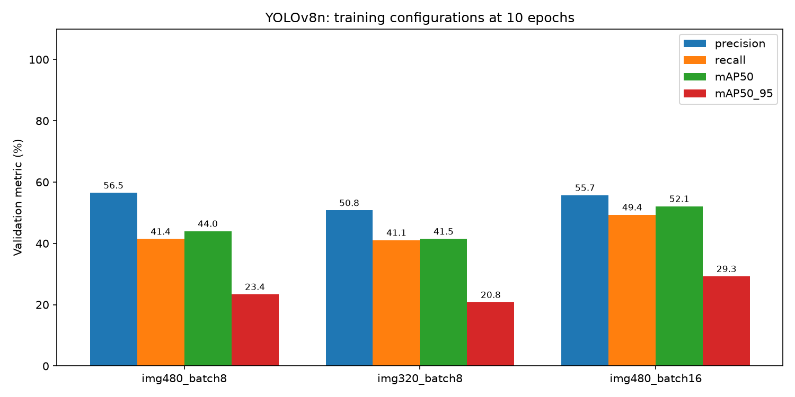
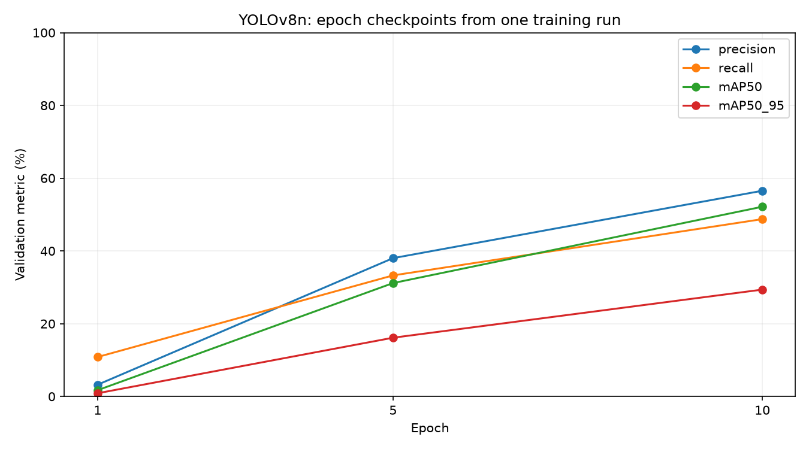
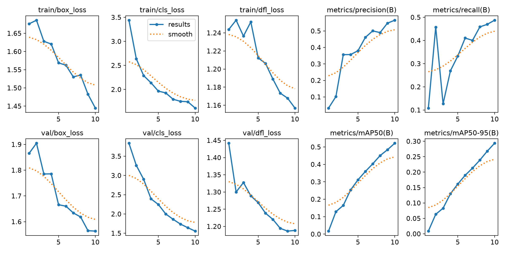
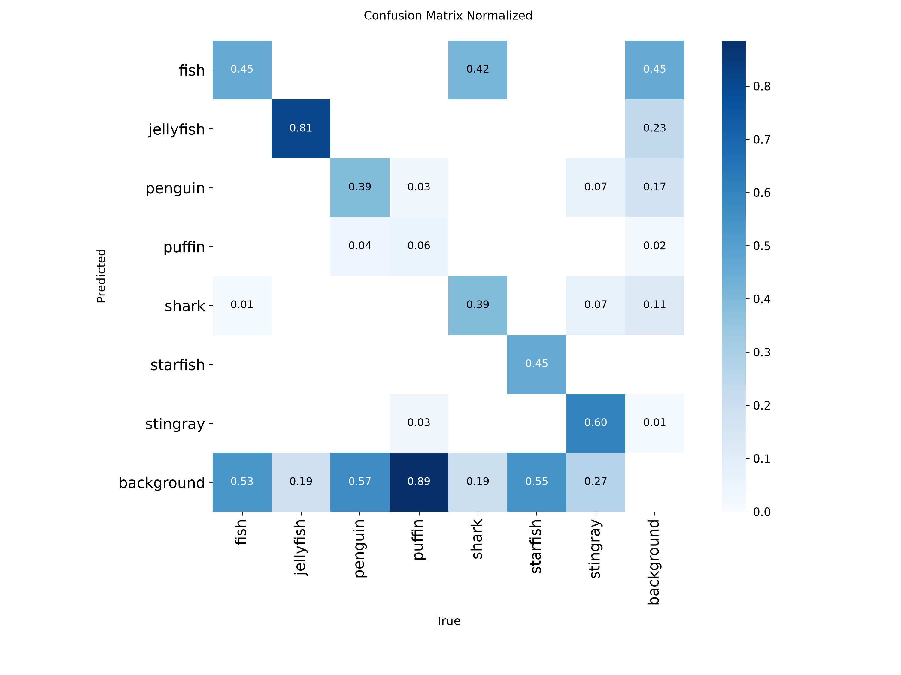
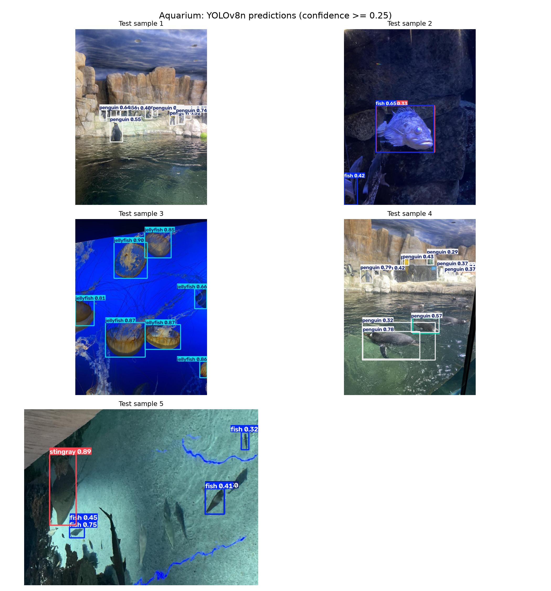
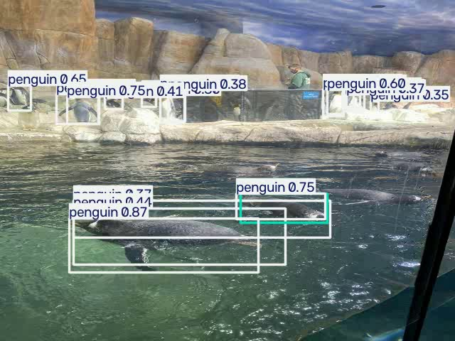

# LAB10 ตรวจจับสัตว์น้ำด้วย YOLOv8

โปรเจกต์นี้ใช้ YOLOv8n ตรวจจับสัตว์น้ำใน Aquarium dataset โดยแสดง bounding box ชื่อคลาส และ confidence ทดลองเปรียบเทียบ image size, batch size และ epochs พร้อมประเมินด้วย Precision, Recall และ mAP

## ภาษาที่ใช้และเครื่องมือ

ใช้ **Python 3.12** เขียนโปรแกรม และ **Markdown** เขียน README

| Library | ใช้ทำอะไร |
| --- | --- |
| Ultralytics / PyTorch | โหลด pretrained YOLOv8n เทรนและตรวจจับวัตถุ |
| OpenCV | อ่านวิดีโอ รับภาพจาก webcam และจัดการ frame |
| Matplotlib / NumPy | สรุปและวาดกราฟผลการทดลอง |
| PyYAML | อ่านพาธข้อมูลและรายชื่อคลาสจาก data.yaml |

## อ้างอิงแหล่งข้อมูล

- Dataset: [Underwater Object Detection Dataset บน Kaggle](https://www.kaggle.com/datasets/slavkoprytula/aquarium-data-cots)
- แหล่งภาพและ annotation ต้นทาง: [Roboflow Aquarium](https://public.roboflow.ai/object-detection/aquarium) เผยแพร่ภายใต้ CC BY 4.0
- โมเดล: [Ultralytics YOLOv8](https://docs.ultralytics.com/models/yolov8/)
- [การเทรน](https://docs.ultralytics.com/modes/train/), [การประเมินผล](https://docs.ultralytics.com/modes/val/) และ [การตรวจจับภาพกับวิดีโอ](https://docs.ultralytics.com/modes/predict/)

มีภาพทั้งหมด **638 รูป** ใช้ split ที่มากับ dataset และตรวจแล้วไม่พบไฟล์ภาพซ้ำข้าม split

| ชุดข้อมูล | ภาพ | Bounding boxes หลังตรวจข้อมูล |
| --- | ---: | ---: |
| Train | 448 | 3,324 |
| Validation | 127 | 909 |
| Test | 63 | 582 |

กำหนด 7 คลาสตามลำดับใน `data.yaml`: `fish`, `jellyfish`, `penguin`, `puffin`, `shark`, `starfish`, `stingray` แต่ละบรรทัดของ label เก็บ `class_id x_center y_center width height` โดยค่ากรอบ normalize เป็น 0-1 ก่อนทดลองตัด annotation ที่กรอบมีขนาดศูนย์ออก 2 จุดใน test และสำรองไฟล์ label เดิมไว้แล้ว

## ผลการรันแบบรูป

ใช้ pretrained YOLOv8n เหมือนกันทุก config, seed 0, AdamW learning rate 0.001 และเทรนแบบละ 10 epochs บน CPU เลือก config ด้วย validation mAP50-95 แล้วใช้ test ประเมินโมเดลสุดท้าย

### เปรียบเทียบ configuration

เทียบผลบน validation ของ `best.pt` ในแต่ละ run ทุกแบบเทรน 10 epochs แล้วเลือกโมเดลด้วย validation mAP50-95

| Configuration | Image size | Batch | Precision | Recall | mAP50 | mAP50-95 |
| --- | ---: | ---: | ---: | ---: | ---: | ---: |
| img480_batch8 | 480 | 8 | 0.5649 | 0.4144 | 0.4400 | 0.2341 |
| img320_batch8 | 320 | 8 | 0.5077 | 0.4106 | 0.4147 | 0.2080 |
| img480_batch16 | 480 | 16 | 0.5573 | 0.4936 | 0.5212 | 0.2927 |



เลือก **img480_batch16** เพราะมี validation mAP50-95 สูงสุดที่ **29.27%**

### เปรียบเทียบ epochs

ใช้ค่าจากรอบ 1, 5 และ 10 ของ training run ที่เลือก เป็นโมเดลที่เรียนรู้ต่อเนื่องกัน ตัวเลขส่วนนี้มาจาก results.csv ระหว่างเทรน ส่วนตาราง configuration ด้านบนประเมินไฟล์ best.pt ที่บันทึกไว้

| Epoch | Precision | Recall | mAP50 | mAP50-95 |
| ---: | ---: | ---: | ---: | ---: |
| 1 | 0.0323 | 0.1084 | 0.0173 | 0.0088 |
| 5 | 0.3801 | 0.3327 | 0.3116 | 0.1614 |
| 10 | 0.5653 | 0.4874 | 0.5214 | 0.2937 |



### Training และ Validation Loss

กราฟแสดง box loss, classification loss, DFL loss และ detection metrics ตลอด 10 epochs ของ config ที่เลือก



### ผลบน Test Set

ประเมินโมเดลที่เลือกบนภาพ test 63 รูป รวม 582 bounding boxes โดยเก็บ test แยกจากการเลือก config

| Precision | Recall | mAP50 | mAP50-95 |
| ---: | ---: | ---: | ---: |
| 0.6435 | 0.5461 | 0.5492 | 0.3357 |



แกนนอนเป็นคลาสจริง แกนตั้งเป็นคลาสที่ทาย ช่อง background แสดงการตรวจจับที่พลาดหรือเกิน

### ตัวอย่าง Detection

สุ่มภาพ test 5 รูปด้วย seed 42 ใช้ confidence threshold 0.25 แล้วแสดง bounding box พร้อมชื่อคลาสและ confidence



### ทดสอบวิดีโอและกล้อง

ทดสอบ pipeline วิดีโอด้วย slideshow ที่สร้างจากภาพ test 6 รูป ความยาว 6 วินาที รวม 60 frames เป็นวิดีโอตัวอย่างจากภาพนิ่ง ไม่ใช่วิดีโอที่ถ่ายมา ดู [ไฟล์ผล detection](runs/aquarium/video_test/video.avi)



มีสคริปต์ตรวจจับผ่าน webcam แต่เครื่องที่ใช้ทดลองเปิด camera index 0 ไม่ได้ จึงยังไม่ได้ยืนยันผลการตรวจจับสด

ตัวเลขเพิ่มเติมอยู่ใน [comparison_configs.csv](runs/aquarium/comparisons/comparison_configs.csv), [comparison_epochs.csv](runs/aquarium/summary/comparison_epochs.csv) และ [metrics.json](runs/aquarium/evaluation/metrics.json)

## โครงสร้างไฟล์

```text
LAB10-Object Detection II/
├── README.md
├── requirements.txt
├── settings.py                 # พาธข้อมูลและโมเดลที่เลือกจาก validation
├── train.py                    # เทรน pretrained YOLOv8n
├── compare_experiments.py      # เปรียบเทียบ image size/batch size และ epochs
├── evaluate.py                 # วัดผลบน test และบันทึก metrics
├── image_test.py               # ตรวจจับภาพ test ตัวอย่าง 5 รูป
├── video_test.py               # ตรวจจับวัตถุทีละ frame ในวิดีโอ
├── realtime_test.py            # ตรวจจับจาก webcam
├── dataset/
│   ├── data.yaml
│   ├── README.dataset.txt      # ที่มาและสิทธิ์การใช้ dataset
│   ├── README.roboflow.txt
│   ├── train/images/, labels/
│   ├── valid/images/, labels/
│   ├── test/images/, labels/
│   └── label_backups/          # label เดิมก่อนตัดกรอบขนาดศูนย์
└── runs/aquarium/
    ├── comparisons/            # ผลเทรนและ best.pt ของแต่ละ config
    ├── selected_model.json     # config และ weights ที่เลือกด้วย validation
    ├── evaluation/             # ผลบน test และ confusion matrix
    ├── image_test/             # ภาพ detection พร้อมชื่อคลาสและ confidence
    ├── video_test/             # ผลตรวจจับวิดีโอตัวอย่าง
    └── summary/                # กราฟ epochs และข้อมูล dataset
```

รูป dataset, environment และไฟล์ weights ถูก git ignore ส่วน CSV, JSON และภาพกราฟเก็บไว้ตรวจผลได้

## สรุปการทำโปรเจกต์

โหลด pretrained YOLOv8n มา fine-tune กับสัตว์น้ำ 7 คลาส ใช้ train สำหรับเรียนรู้ validation สำหรับเลือก config และ test สำหรับวัดผลสุดท้าย โค้ดแบ่งส่วนเทรน เปรียบเทียบ ประเมิน และตรวจจับภาพ วิดีโอ กับกล้องออกจากกัน

จากการทดลองเลือก img480_batch16 ซึ่งได้ test mAP50 **54.92%** และ mAP50-95 **33.57%** โดยมี Precision 0.6435 และ Recall 0.5461 คะแนนยังสะท้อนว่ามีทั้งวัตถุที่ตรวจพลาดและการทายเกิน จึงดู confusion matrix และภาพ detection ประกอบด้วย

การเปลี่ยนขนาดภาพและ batch size ทำให้ผลแตกต่างกัน ผลนี้ใช้ split และ seed เดียว จึงเป็นข้อสรุปเฉพาะการตั้งค่าที่ทดลอง ส่วนวิดีโอทดสอบจาก slideshow และยังไม่ได้ทดสอบกล้องสด
